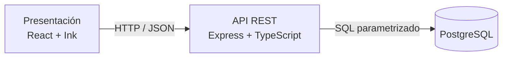
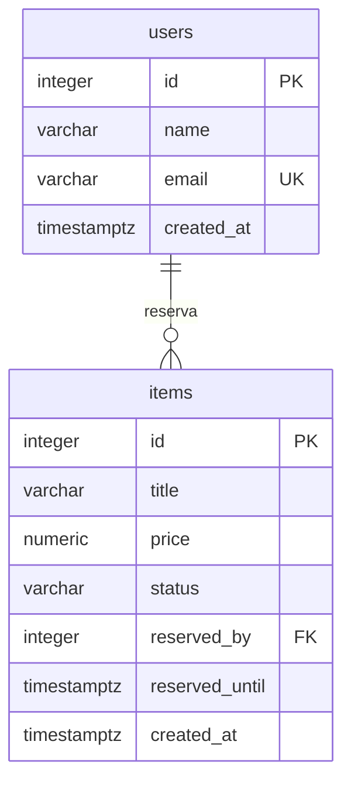
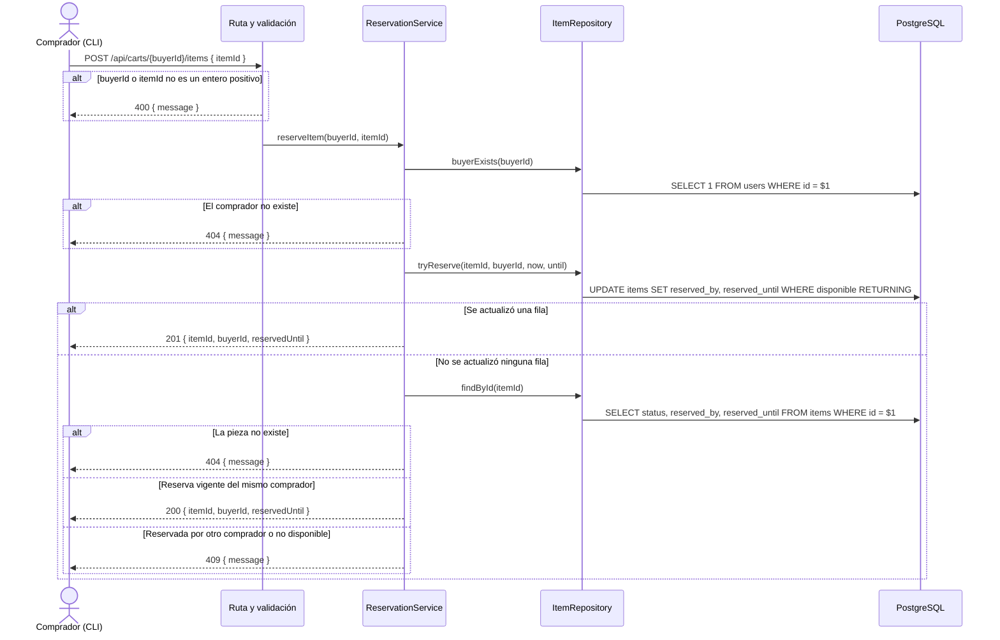

# Descripción del diseño y la arquitectura

Este documento describe el diseño de Legado&Origen siguiendo los cinco elementos del modelo de diseño de Pressman: arquitectura, datos, interfaces, componentes y despliegue. El diseño evoluciona de forma incremental: cada historia de usuario agrega o modifica los elementos que necesita, y cada sección indica la historia que lo originó. Todo cambio a este documento se integra mediante un pull request revisado con el checklist de diseño (Fase 2, Diseño, Actividad 1).

## 1. Arquitectura

El sistema se separa en tres capas, conforme a RNF-013:

| Capa | Tecnología | Responsabilidad |
|---|---|---|
| Presentación | React con Ink (aplicación de terminal) | Interacción con el usuario |
| Servicios (API REST) | Node.js 22, Express 5 y TypeScript | Reglas de negocio y validación |
| Persistencia | PostgreSQL | Almacenamiento de los datos |

La capa de presentación se implementa como una aplicación de terminal en lugar de una aplicación web, por decisión del equipo aprobada por el profesor. La presentación se comunica con la API únicamente mediante HTTP y JSON, y nunca accede directamente a la base de datos.



Dentro de la API, cada solicitud recorre las capas ruta, servicio y repositorio. La ruta valida la forma de la entrada, el servicio aplica las reglas de negocio y el repositorio es el único componente que ejecuta SQL. Los errores se propagan al middleware centralizado, que responde con un mensaje genérico (RNF-005).

## 2. Datos

### Diagrama entidad-relación (HU-08)



### Tablas

**`users`**: versión mínima, necesaria para identificar al comprador que reserva. HU-01 la extenderá con las credenciales.

| Columna | Tipo | Restricciones |
|---|---|---|
| `id` | `INTEGER` | Llave primaria, generada |
| `name` | `VARCHAR(150)` | No nula |
| `email` | `VARCHAR(150)` | No nula, única |
| `created_at` | `TIMESTAMPTZ` | No nula, por defecto `now()` |

**`items`**: piezas del catálogo. HU-08 define las columnas necesarias para la reserva; HU-04 agregará los atributos propios de las antigüedades (época, procedencia, estado de conservación, certificados y fotografías).

| Columna | Tipo | Restricciones |
|---|---|---|
| `id` | `INTEGER` | Llave primaria, generada |
| `title` | `VARCHAR(150)` | No nula |
| `price` | `NUMERIC(12, 2)` | No nula, mayor que cero (HU-04) |
| `status` | `VARCHAR(20)` | No nula; `pending_approval`, `available`, `rejected` o `sold` |
| `reserved_by` | `INTEGER` | Llave foránea a `users(id)`; nula si no hay reserva |
| `reserved_until` | `TIMESTAMPTZ` | Nula si no hay reserva |
| `created_at` | `TIMESTAMPTZ` | No nula, por defecto `now()` |

Restricción `items_reservation_consistency`: `reserved_by` y `reserved_until` son ambas nulas o ambas no nulas, de modo que no puede existir una reserva sin comprador o sin vencimiento.

### Decisiones de diseño de datos

- **La reserva se guarda en la propia pieza y no en una tabla aparte.** Una pieza única solo puede tener una reserva a la vez, y guardarla en la misma fila permite reservar con una única operación atómica (sección 4).
- **El carrito no tiene tabla propia.** El carrito de un comprador está formado por las piezas con una reserva vigente a su nombre (RF-011, parcial).
- **Una reserva vencida no se borra.** Deja de ser vigente cuando `reserved_until` es menor o igual que el instante actual, y la siguiente reserva la sobrescribe. Así no se necesita un proceso periódico de limpieza.
- **Los instantes se guardan con zona horaria (`TIMESTAMPTZ`)**, para evitar errores de conversión entre el servidor y la base de datos.

El esquema se define en `backend/src/db/schema.sql`.

```sql
CREATE TABLE IF NOT EXISTS users (
  id INTEGER GENERATED ALWAYS AS IDENTITY PRIMARY KEY,
  name VARCHAR(150) NOT NULL,
  email VARCHAR(150) NOT NULL UNIQUE,
  created_at TIMESTAMPTZ NOT NULL DEFAULT now()
);

CREATE TABLE IF NOT EXISTS items (
  id INTEGER GENERATED ALWAYS AS IDENTITY PRIMARY KEY,
  title VARCHAR(150) NOT NULL,
  price NUMERIC(12, 2) NOT NULL CHECK (price > 0),
  status VARCHAR(20) NOT NULL DEFAULT 'pending_approval'
    CHECK (status IN ('pending_approval', 'available', 'rejected', 'sold')),
  reserved_by INTEGER REFERENCES users (id),
  reserved_until TIMESTAMPTZ,
  created_at TIMESTAMPTZ NOT NULL DEFAULT now(),
  CONSTRAINT items_reservation_consistency
    CHECK ((reserved_by IS NULL) = (reserved_until IS NULL))
);
```

## 3. Interfaces

Todas las respuestas de error tienen la forma `{ "message": string }` y se generan en el middleware centralizado (RNF-005).

### `POST /api/carts/{buyerId}/items` (HU-08)

Agrega una pieza al carrito del comprador y la reserva por 15 minutos.

**Parámetros**

| Nombre | Ubicación | Tipo | Regla |
|---|---|---|---|
| `buyerId` | Ruta | Entero | Mayor que cero |
| `itemId` | Cuerpo (JSON) | Entero | Mayor que cero |

Ejemplo de cuerpo:

```json
{ "itemId": 12 }
```

**Respuestas**

| Código | Cuándo | Cuerpo |
|---|---|---|
| `201 Created` | Se creó la reserva | `{ "itemId": 12, "buyerId": 3, "reservedUntil": "2026-11-24T16:15:00.000Z" }` |
| `200 OK` | El comprador ya tenía una reserva vigente de la pieza; no se extiende (criterio 6) | Igual que en `201`, con el vencimiento original |
| `400 Bad Request` | `buyerId` o `itemId` no es un entero mayor que cero | `{ "message": "Solicitud inválida" }` |
| `404 Not Found` | El comprador o la pieza no existe | `{ "message": "Recurso no encontrado" }` |
| `409 Conflict` | La pieza está reservada por otro comprador, vendida, pendiente de aprobación o rechazada (criterios 2 y 5) | `{ "message": "La pieza no está disponible" }` |
| `500 Internal Server Error` | Error inesperado | `{ "message": "Ocurrió un error en el servidor. Inténtalo de nuevo más tarde." }` |

El mensaje de `409` es el mismo en todos los casos: no revela si la pieza está reservada o vendida, ni quién la reservó.

**Alcance:** mientras HU-01 no esté implementada, el comprador se identifica por el `buyerId` de la ruta, sin autenticación. RF-003 queda fuera del alcance de esta interfaz (ver el issue de HU-08).

## 4. Componentes

### Componentes de HU-08

| Componente | Archivo | Responsabilidad |
|---|---|---|
| Configuración | `backend/src/config/index.ts` | Duración de la reserva (`RESERVATION_MINUTES`, 15 por defecto), leída de la configuración y no fija en el código |
| Pool de conexiones | `backend/src/db/pool.ts` | Única conexión compartida con PostgreSQL (RNF-016) |
| Ruta del carrito | `backend/src/modules/carts/cart-routes.ts` | Valida `buyerId` e `itemId` y delega en el servicio |
| Servicio de reservas | `backend/src/modules/carts/reservation-service.ts` | Aplica las reglas de la reserva y decide el código de respuesta |
| Repositorio de piezas | `backend/src/modules/carts/item-repository.ts` | Ejecuta el SQL de consulta y reserva |
| Reloj | `backend/src/shared/clock.ts` | Entrega el instante actual; en las pruebas se reemplaza por un reloj controlado |
| Manejo de errores | `backend/src/middleware/error-handler.ts` | Responde los errores con mensajes genéricos (RNF-005) |

El servicio recibe el instante actual desde el reloj y se lo pasa al repositorio. Esto permite que las pruebas fijen el instante y verifiquen los valores límite del vencimiento (CP-03 y CP-06).

### Reserva atómica (RNF-007)

La reserva se realiza con una sola sentencia `UPDATE` que solo modifica la pieza si está disponible y sin una reserva vigente. PostgreSQL bloquea la fila durante la actualización, así que entre solicitudes simultáneas solo una cumple la condición; las demás no modifican ninguna fila.

```sql
UPDATE items
SET reserved_by = $1,
    reserved_until = $2::timestamptz + make_interval(mins => $3)
WHERE id = $4
  AND status = 'available'
  AND (reserved_by IS NULL OR reserved_until <= $2::timestamptz)
RETURNING id, reserved_by, reserved_until;
```

`$1` es el comprador, `$2` el instante actual, `$3` la duración en minutos y `$4` la pieza. Si no se modificó ninguna fila, el servicio consulta la pieza para distinguir entre "no existe" (`404`), "reserva vigente del mismo comprador" (`200`) y "no disponible" (`409`).

### Diagrama de secuencia (HU-08)



## 5. Despliegue

| Ambiente | Componentes |
|---|---|
| Desarrollo local | Node.js 22 y PostgreSQL 16, configurados mediante variables de entorno (`.env`, excluido del repositorio) |
| Integración continua | GitHub Actions con PostgreSQL 16 como contenedor de servicio; la base de datos de prueba se recrea en cada ejecución (Fase 2, Pruebas, Actividad 1) |
| Producción | Por definir |

## Trazabilidad

| Criterio de HU-08 | Elemento de diseño |
|---|---|
| 1. Reserva por 15 minutos | `RESERVATION_MINUTES` y `reserved_until` |
| 2. Otro comprador no puede reservar | Condición del `UPDATE` y respuesta `409` |
| 3. Liberación al cumplirse 15 minutos | `reserved_until <= now` en el `UPDATE` |
| 4. Concurrencia | `UPDATE` atómico (RNF-007) |
| 5. Pieza no disponible | `status = 'available'` en el `UPDATE` y respuesta `409` |
| 6. Misma reserva sin extensión | El `UPDATE` no modifica una reserva vigente; respuesta `200` |